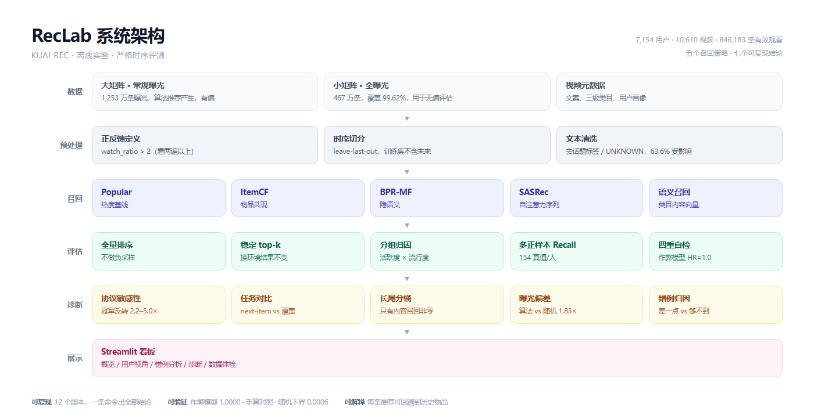
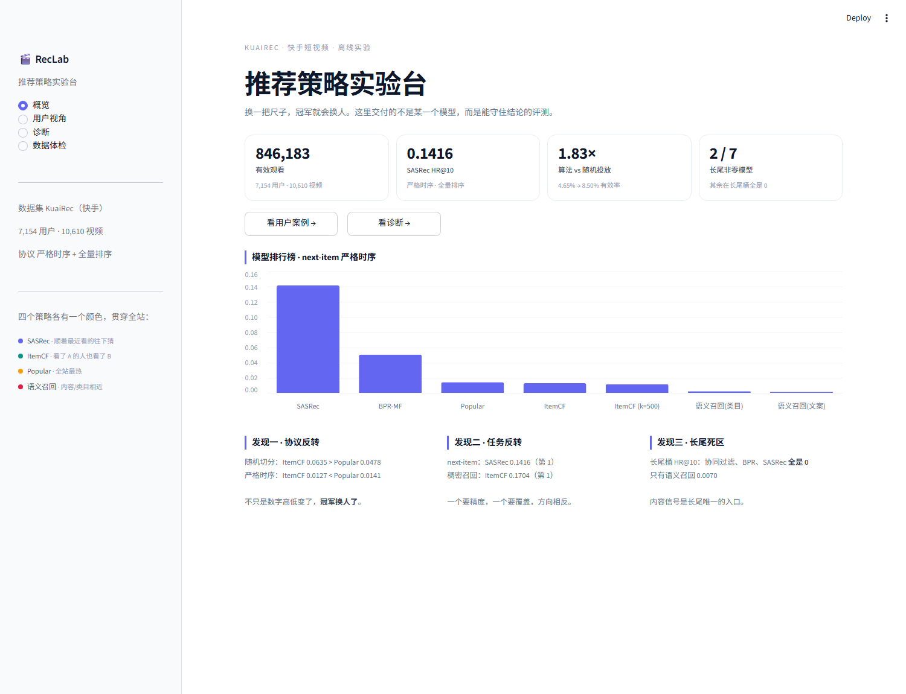
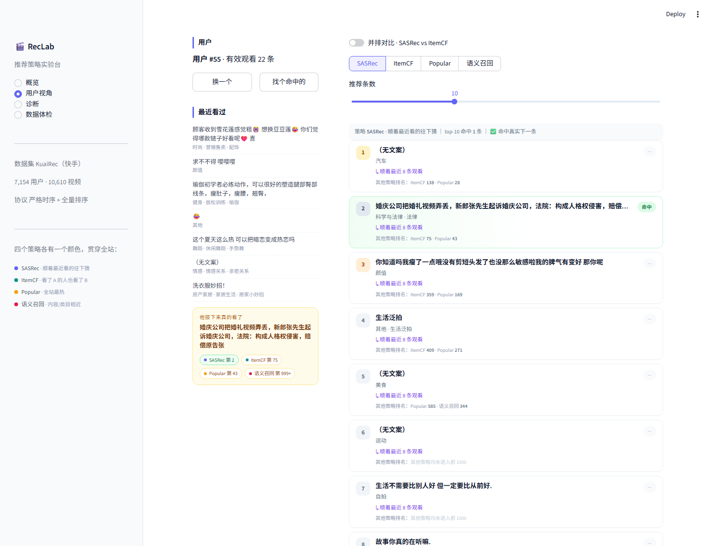
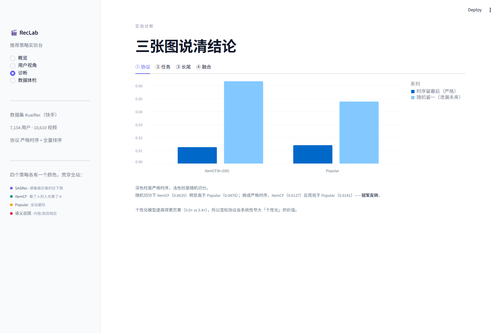
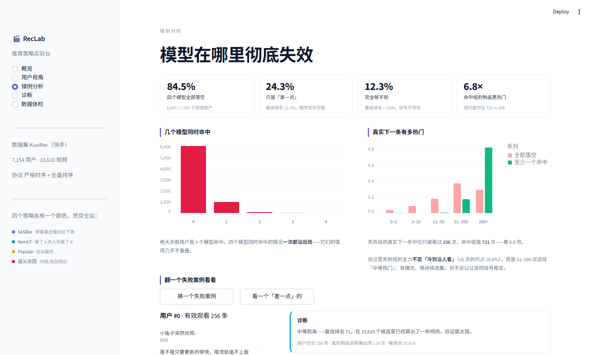

# RecLab · 短视频推荐实验平台

## 一句话：这个项目做什么

给 7,175 个快手用户的观影行为做短视频推荐：每个人有一串"有效观看"记录，系统要在他们没看过的视频里排出 10 条最可能想看的。

但「能排出 10 条」不是重点——任何推荐库几行代码就能做到。重点是能回答三个问题：

1. **这 10 条是怎么来的？** 热门榜 / 相似物品 / 隐语义 / 行为序列 / 文本语义
2. **换一种策略谁更好，好多少？** 同一批数据、同一套规则，公平比赛
3. **它在什么情况下不管用？** 按用户活跃度和视频流行度拆开看，找到失效边界

举个真实例子（`python -m scripts.show_demo`）：

```
用户 #486 最近有效观看：军训、生活泛拍、婚礼视频官司、一天太悠闲了 ...
        他接下来真的看了：#真人真事传播正能量 #坚持拍高清视频 ...

Popular 推荐：汽车日常、女子穿"钉子裤"坐公交车 ...      ← 当天最热
SASRec 推荐：暖心 孙子给奶奶电话贴照片、从兵哥哥到警察 ...  ★ 第 2 名命中
```

`HR@10 = 0.14` 的意思是：100 个用户里，有 14 个，系统推荐的前 10 条包含了他真正看的那条。
候选池是 10,611 个视频，瞎猜只有 0.094% —— **0.14 是瞎猜的 150 倍**。

---

## 系统架构



数据 → 预处理 → 五路召回 → 评估 → 诊断 → 看板，每一层都能单独跑、单独验。

## 先看这两个

| 文档 | 内容 |
|---|---|
| [一页纸结论](docs/一页纸.md) | 2 分钟读完：四个数字、五条结论、边界与不足 |
| [3 分钟演示脚本](docs/演示脚本.md) | 逐秒说明：说什么、点哪里、看什么，附带备用问答与三个别踩的坑 |

---

## 可视化看板

一个 Streamlit 应用，五个界面把结论讲完，不需要看任何 CSV。四个策略各有一个固定颜色，贯穿全站。



**概览** —— 四个指标实时算出来（没有一个写死的数字），加两个快捷入口。



**用户视角**（演示主战场）：

- 切策略，同一批卡片原地换掉；拖动滑块改推荐条数
- 绿色卡片 = 命中真实的下一条；卡片顶部是金/银/铜勋章
- 「↳」是推荐理由：ItemCF / 语义召回能回溯到具体历史视频，SASRec 只能说「顺着最近 8 条」
- **「其他策略排名」**：同一个视频在别的策略里排第几。这张图里 SASRec 排第 2 的视频，Popular 排第 43，语义召回直接掉出前 1000
- **左下角「真实下一条」的四路排名**：一眼看出哪个模型抓到了、哪个完全没戏



**诊断** —— 四个标签页：协议、任务、长尾、融合。每个标签页一张图 + 一段结论。



**错例分析** —— 正面案例证明方法有效，反面案例定义方法边界。翻一个「四个模型全都落空」的用户，
看他的真实下一条被排到了第几名，以及这次失败属于「差一点」还是「完全够不到」。

```bash
streamlit run app/dashboard.py --server.port 8501
```

首次打开约 30 秒（构建并磁盘缓存 ItemCF / 语义模型），之后 5 秒内出页面。
支持 URL 深链：`?page=overview` / `?page=user` / `?page=diag` / `?page=data`。

---

## 技术版：为什么值得做

市面上大多数「推荐算法项目」的流程是：随机切分 → 采样负例 → 训一个模型 → 报一个漂亮数字。
这条链路有两个问题：**训练集里含有未来信息**，**采样评估会系统性高估热门物品**。

本项目走另一条路：

1. **严格时序切分**（leave-last-out），训练集绝不含测试时刻之后的信息；
2. **全量排序评估**，不做负采样，候选集 = 全部视频 − 用户已交互视频；
3. **稳定 top-k**，同分按下标定序，换 numpy 版本也得到完全相同的数字；
4. **分组归因**，把指标拆到「用户活跃度」和「视频流行度」两个维度；
5. **超参只在验证集上调**，测试集只用于最终报告。

在这个更严格的尺子下，最重要的发现不是「哪个模型最强」，而是**尺子本身会改变结论**（见发现一）。

---

## 数据

[KuaiRec](https://zenodo.org/records/18164998)（快手公开数据集，含两套曝光矩阵）：

| | 大矩阵（常规曝光） | 小矩阵（稠密曝光） |
|---|---|---|
| 规模 | 12,530,806 条曝光 | 4,676,570 条曝光 |
| 用户 × 视频 | 7,176 × 10,728 | 1,411 × 3,327 |
| 覆盖率 | 16.28% | **99.62%** |
| 用途 | 训练与主评测 | **无偏评估** |

正反馈定义：`watch_ratio = 播放时长 / 视频时长 > 2`（看了两遍以上），这是 KuaiRec 论文的「有效观看」口径。过滤后剩 **846,253 条**交互 / 7,175 用户 / 10,611 视频，稀疏度 1.11%，人均 117.9 条。

> 小矩阵是 KuaiRec 独有的宝藏：它几乎记录了每个用户对每个视频的真实反馈，
> 而且这些视频**刻意避开了用户的常规信息流**——所以它本质是一次随机曝光实验，
> 能回答「如果推给他，他会不会看」，这是普通数据集做不到的（见发现四）。

---

## 环境

| 项 | 值 |
|---|---|
| Python | 3.12 |
| PyTorch | 2.14.1+cu126（纯 CPU 也能跑，SASRec 会慢 10 倍左右） |
| GPU | RTX 4060 Laptop 8GB（sm_89） |
| 数据目录 | `data/`，可用环境变量 `RECLAB_DATA` 指向别处 |

```bash
python -m venv .venv
.venv\Scripts\activate                                              # Windows
pip install -r requirements.txt
pip install torch --index-url https://download.pytorch.org/whl/cu126   # 按显卡驱动选版本
```

## 快速开始

```bash
pip install -r requirements.txt       # 不含 torch，云端同款依赖
streamlit run app/dashboard.py        # 打开看板 http://localhost:8501
```

仓库里已经带了 **10.1 MB 的精简数据包**（`assets/demo/`）和 **预计算好的实验结果**（`results/`），
所以**克隆下来直接就能跑**——不用下载 412 MB 原始数据，也不用重训模型。

想跑 SASRec 或从零复现全部数字：

```bash
pip install -r requirements-torch.txt  # torch，仅 SASRec 需要
python -m scripts.download_kuairec     # 原始数据（约 412 MB，支持断点续传）
python -m scripts.train_sasrec         # GPU 约 80 秒
```
想复现全部数字，按下面的顺序跑：

```bash
python -m scripts.test_sanity        # 评估链路自检（先跑这个）
python -m src.run_experiments        # Popular / ItemCF
python -m scripts.train_bpr          # BPR-MF
python -m scripts.train_sasrec       # SASRec
python -m scripts.semantic_recall --source category   # 语义召回
python -m scripts.protocol_compare   # 协议敏感性
python -m scripts.exposure_bias      # 曝光偏差
python -m scripts.dense_eval         # 稠密多正样本
python -m scripts.failure_analysis   # 错例归因
python -m scripts.report             # 汇总 -> results/report.md
```

---

## 已通过的正确性自检

评估代码最怕「看起来对」。四种方式证明它是对的：

| 自检 | 结果 | 含义 |
|---|---|---|
| 作弊模型（把答案放第 1 名） | HR@10 = **1.0000** | 评估链路没有丢答案 |
| 手算 3×3 共现矩阵的 ItemCF | 相似度、打分均一致 | 模型实现无误 |
| 随机打分模型 | HR@10 = 0.0027（理论 10/3533） | 没有隐藏泄漏 |
| 测试物品是否被误 mask | 0 条 | 候选集构造正确 |

---

## 基线结果

协议：leave-last-out + 全量排序，KuaiRec，`watch_ratio > 2`。

| 模型 | HR@10 | NDCG@10 | HR@20 | NDCG@20 | MRR |
|---|---|---|---|---|---|
| **SASRec** (h=64, L=50, 2层) | **0.1416** | **0.0787** | **0.2143** | **0.0970** | **0.0646** |
| BPR-MF (d=64) | 0.0505 | 0.0193 | 0.0749 | 0.0256 | 0.0121 |
| Popular | 0.0141 | 0.0052 | 0.0327 | 0.0098 | 0.0039 |
| ItemCF (k=200) | 0.0127 | 0.0052 | 0.0324 | 0.0101 | 0.0043 |
| ItemCF (k=500, α=0.7) | 0.0115 | 0.0051 | 0.0214 | 0.0076 | 0.0039 |

SASRec 是 Popular 的 **10 倍**。而 ItemCF **低于**流行度基线——这在 MovieLens 上是不会发生的（见发现二）。

---

## 三个发现

### 发现一：换个切分方式，结论直接反转

同一份数据、同两个模型，只改切分协议：

| 模型 | 随机切分（泄漏未来） | 严格时序切分 | 倍差 |
|---|---|---|---|
| Popular | 0.0478 | 0.0141 | 3.39× |
| ItemCF (k=200) | **0.0635** | **0.0127** | **4.99×** |

**随机切分下 ItemCF 明显强于 Popular（0.0635 > 0.0478）；严格时序下 ItemCF 反而输给 Popular（0.0127 < 0.0141）。**

也就是说，用什么切分方式，不仅决定数字高低，还决定**谁赢**。而个性化模型虚高得更厉害（5.0× vs 3.4×），所以宽松协议会系统性夸大"个性化"的价值。

论文里「ML-1M 上 HR@10 能到 0.7」这类数字，多数来自随机切分 + 采样评估。这不是模型强，是协议松。

### 发现二：短视频场景下，协同过滤几乎失效

| 模型 | HR@10 | 相对 Popular |
|---|---|---|
| SASRec | 0.1416 | **10.0×** |
| BPR-MF | 0.0505 | 3.6× |
| Popular | 0.0141 | 1.0× |
| ItemCF | 0.0127 | **0.9×** |

ItemCF 打不过「什么都不做，只推热门」——原因是数据本身：

- 用户相邻两次有效观看的**间隔中位数是 24 小时**，只有 6.1% 在 1 小时内连续刷（`scripts/explore_kuairec` 可复现）。
- 短视频生命周期以天计，物品共现的时间窗口太窄，item-item 相似度基本是噪声。
- 而序列模型学的是**用户稳定的品类偏好**（颜值、搞笑、影视剪辑…），所以能跨天泛化。

这不是实现问题，是「物品生命周期 ≪ 用户生命周期」时的结构性失败。**换成电影（生命周期几十年）就不成立**——这正是本项目从 MovieLens 迁到 KuaiRec 后最有价值的发现。

### 发现三：所有模型在长尾上都是 0

按「被预测视频在训练集中的出现次数」分桶（长尾 20% / 中部 40% / 头部 40%）：

| 模型 | 长尾 HR@10 | 中部 HR@10 | 头部 HR@10 |
|---|---|---|---|
| Popular | 0.0000 | 0.0000 | 0.0355 |
| ItemCF | 0.0000 | 0.0000 | 0.0319 |
| BPR-MF | 0.0000 | 0.0000 | 0.1267 |
| SASRec | 0.0000 | 0.0613 | 0.2938 |
| Semantic（类目） | **0.0070** | 0.0007 | 0.0011 |

**连最强的 SASRec 在长尾桶上也是 0**。这不是调参能解决的：交互稀疏的视频没有足够证据被排进 top-10。

唯一例外是最后一行——语义召回（见发现六）。它在头部几乎无能，却**唯独在长尾上拿到了非零**。

### 发现四：算法推荐相对随机投放，只有 1.83 倍增益

KuaiRec 对 1,411 个用户额外做了一次**随机曝光实验**：把 3,327 个视频直接推给他们，不管算法会不会推。于是同一批用户身上同时有两种数据，可以配对比较（`python -m scripts.exposure_bias`）：

| | 算法推荐（常规信息流） | 随机曝光 |
|---|---|---|
| 人均曝光 | 357 条 | 3,314 条 |
| 有效率（均值） | **8.50%** | 4.65% |
| 有效率（中位数） | 7.88% | 2.86% |

- 均值增益 **1.83×**，中位数增益 2.75×（均值被少数"算法失灵"的用户拉低）
- **84.8%** 的用户，算法确实优于随机投放
- Wilcoxon 配对检验 p < 1e-150

三个推论：

1. **推荐系统有用，但增幅远小于直觉。** 有效率从 4.65% 提到 8.50%，意味着用户看到的内容里 **91.5% 仍然是他不会看完的**。
2. **负采样的标签噪声 ≈ 4.65%。** 训练时被当作负样本的未曝光视频里，每 22 个就有 1 个其实是他会看完两遍的。
3. **每个用户平均有 154 个「会喜欢但从未出现在信息流里」的视频。** 这部分兴趣被曝光机制系统性遮蔽，模型再强也学不到——这是离线指标与真实兴趣之间最难弥合的缺口。

---

### 发现五：换一个评估任务，冠军再次反转

同一个模型，在「next-item」和「稠密多正样本召回」两种协议下的排名：

| 模型 | next-item HR@10 | 稠密 Recall@20 |
|---|---|---|
| SASRec | **0.1416（第 1）** | 0.0756（第 3） |
| Popular | 0.0141（第 3） | 0.1467（第 2） |
| ItemCF | 0.0127（第 4） | **0.1704（第 1）** |
| Semantic（类目） | 0.0021（第 5） | 0.0065（第 4） |
| Random（理论） | 0.0009 | 0.0061 |

**同一个 SASRec，在 A 任务里是 10 倍于基线的冠军，在 B 任务里输给「只推热门」。**

原因不是模型坏了，是两个任务要的东西相反：
- **next-item** 问「能不能猜中紧接着的那一条」→ 需要把概率压在少数几个上（precision）
- **稠密召回** 问「能不能覆盖他 154 个兴趣中的更多」→ 需要把分数摊开（coverage）

SASRec 用交叉熵训练，天然把分布压尖；ItemCF 对历史求和，天然摊平。所以**评估任务的选择，和切分协议一样会决定胜负**。

这也是一个实操结论：如果你只做 next-item 评测就选模型，上线后会发现「猜得准但推得窄」。

---

### 发现六：语义召回整体最弱，却是唯一能碰到长尾的方法

| 模型 | 整体 HR@10 | 长尾 HR@10 |
|---|---|---|
| SASRec | **0.1416** | 0.0000 |
| BPR-MF | 0.0505 | 0.0000 |
| Popular | 0.0141 | 0.0000 |
| ItemCF | 0.0127 | 0.0000 |
| Semantic（类目） | 0.0021 | **0.0070** |

语义召回整体只有 0.0021，比「只推热门」还差 7 倍。**但在长尾桶上，它是唯一非零的模型。**

原因很清楚：
- 协同过滤对长尾物品没有共现证据，得分恒为 0，无论怎么调参都救不回来
- 语义召回只看类目，不需要任何人看过
- 所以它的价值不是「更准」，而是「**在 CF 完全失效的地方存在**」

这直接给出了多路召回的正确做法：不是把几个模型加权平均，而是**按场景路由**——头部走协同/序列，长尾走内容。

**三个踩坑记录**（都写进了代码注释）：

1. 第一版用「用户历史向量取平均」，HR@10 = 0.0014，几乎等于随机。118 个不同视频平均出来的是一个「平均口味」，和谁都不像。改成「取最大相似度」（内容版 ItemCF）后升到 0.0080。
2. 第一版直接把 caption 拼进去，但 **63.6% 的文本含 `UNKNOWN`**，还有大量 `#感谢快手我要上热门` 这类出现在几乎每个视频里的模板标签——TF-IDF 把所有视频编码成了几乎相同的向量。清洗后稠密指标从 0.0067 升到 0.0100。
3. 本机 PyPI 连接会被重置，`sentence-transformers` 装不上，BGE 中文向量这条路没走通。当前结果是纯 TF-IDF + SVD 的下限，用真向量模型应该还有空间。

#### 融合实验：加语义通道值不值？

在**固定候选预算 130** 下比较三种分法（`python -m scripts.fusion_recall`）：

| 策略 | 整体命中率 | 长尾 GT | 头部 GT |
|---|---|---|---|
| 130 全给 SASRec | **0.4747** | 0.0356 | **0.7339** |
| 100 SASRec + 30 语义（全量） | 0.4332 | 0.0335 | 0.6883 |
| 100 SASRec + 30 语义（**只补长尾**） | 0.4339 | **0.0433** | 0.6866 |

结论：**路由版把长尾命中率提高了 21.6%，但整体掉 4.08 个百分点。**

原因是预算守恒——分给长尾的名额，本来能捞到更多头部用户。所以：

- 只考核整体命中率 → **不要加**语义通道，把预算全给序列模型；
- 若长尾（新品冷启动、内容多样性）有独立考核目标 → 值得加，因为它换来的长尾增益是实打实的。

这是一个「**不该做**」的结论，但它是量化过的、有边界的。能说清"什么情况下不划算"，比盲目堆模型更接近工程判断。

### 发现七：84.5% 的用户，四个模型全落空

对全部 7,154 个测试用户，统计四个策略各自把「真实下一条」排到第几名（`python -m scripts.failure_analysis`）：

| 同时命中的模型数 | 用户数 | 占比 |
|---|---|---|
| 0 个 | 6,047 | 84.5% |
| 1 个 | 1,001 | 14.0% |
| 2 个 | 91 | 1.3% |
| 3 个 | 15 | 0.2% |
| 4 个 | **0** | **0%** |

四个模型同时命中的情况**一次都没出现**——它们的强项几乎不重叠。

失败者内部再拆一层：

- **24.3%** 是「差一点」：最佳排名 11–50，排序优化可救
- **12.3%** 是「完全够不到」：最佳排名 > 1000，信号根本不存在
- 命中组的真实下一条流行度中位 **721**，失败组 **106**，差 6.8 倍

最后一个细节最反直觉：**失败的主力不是极冷物品**（≤5 次交互的只占 10.6%），而是 **51–200 次的「中等热门」**——有曝光、够进候选集，但不足以让协同信号稳定。

> 对工程的含义：把「差一点」当成「够不到」，会白费力气换模型；
> 把「够不到」当成「差一点」，则会无休止调排序参数。

## 在线部署

精简数据包 + 无 torch 依赖，使这个看板可以直接部署到 Streamlit Community Cloud（免费额度足够）。
步骤见 [DEPLOY.md](DEPLOY.md)：创建一个公开的 `.streamlit.app` 链接，任何人点开就能看。

> 云端会禁用 SASRec（省内存），其余四个策略与全部图表照常工作。

---

## 目录结构

```
app/
  dashboard.py         # Streamlit 看板（4 个页面）
.streamlit/
  config.toml          # 锁定浅色主题
src/
  config.py            # 路径、正反馈阈值、评估参数
  data_utils.py        # MovieLens / KuaiRec 两个加载器 + 统一入口
  split.py             # 时序切分 / 随机切分
  metrics.py           # HR/NDCG/MRR、覆盖率、稳定 top-k、分组归因
  text.py              # 文案清洗（去话题标签/UNKNOWN）
  artifacts.py         # 看板产物：模型缓存、推荐、解释、分桶
  run_experiments.py   # 经典基线主入口
  models/
    popular.py  itemcf.py  bpr.py  sasrec.py  semantic.py
scripts/
  explore_kuairec.py   # 数据探查
  test_sanity.py       # 评估链路自检
  test_app.py          # 看板逐页回归（AppTest）
  check_bundle.py      # 不启动 Streamlit 也能检查看板依赖
  tune_itemcf.py       # 验证集调参
  protocol_compare.py  # 协议敏感性（发现一的出处）
  exposure_bias.py     # 算法 vs 随机曝光（发现四）
  failure_analysis.py  # 全员失败案例与归因（发现七）
  dense_eval.py        # 稠密多正样本 Recall@K（发现五）
  semantic_recall.py   # 语义召回（发现六）
  fusion_recall.py     # 多路融合消融
  train_bpr.py  train_sasrec.py
  report.py            # 汇总报表
  show_demo.py         # 单用户推荐演示
data / results / docs
```

---

## 进度与下一步

| 阶段 | 内容 | 状态 |
|---|---|---|
| 数据管线（KuaiRec 迁移） | 加载、缓存、统计、演示 | ✅ |
| 评估框架 | 时序切分、全量排序、稳定 top-k、分组归因 | ✅ |
| 经典基线 | Popular、ItemCF（含调参） | ✅ |
| 深度基线 | BPR-MF、SASRec（GPU） | ✅ |
| 协议敏感性 | 随机 vs 时序（发现一） | ✅ |
| **曝光偏差量化** | **算法推荐 vs 随机曝光（发现四，D8）** | ✅ |
| **稠密多正样本评估** | **Recall@K + 任务反转（发现五，D9）** | ✅ |
| 语义召回 | 类目/文案向量 + 内容相似度（发现六） | ✅ |
| 多路融合 | 固定预算下路由不划算（长尾 +21.6%，整体 −4.08pp） | ✅ |
| **可视化看板** | **4 页 Streamlit：概览 / 用户视角 / 诊断 / 数据体检** | ✅ |
| 收尾 | 演示脚本、架构图、3 分钟讲解 | ⬜ 下一步 |

执行路径已经走完：数据 → 评估 → 基线 → 诊断 → 语义召回 → 融合 → 看板。
剩下的是演示包装——一页纸结论、一张架构图、一段 3 分钟的讲解顺序。

详见 [`docs/方案.md`](docs/方案.md)。
